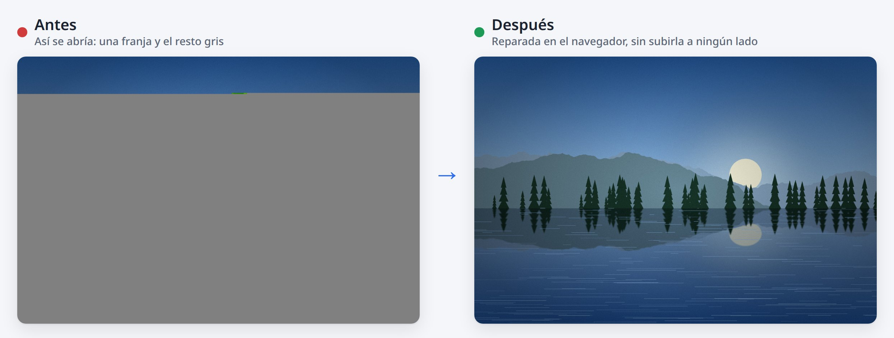
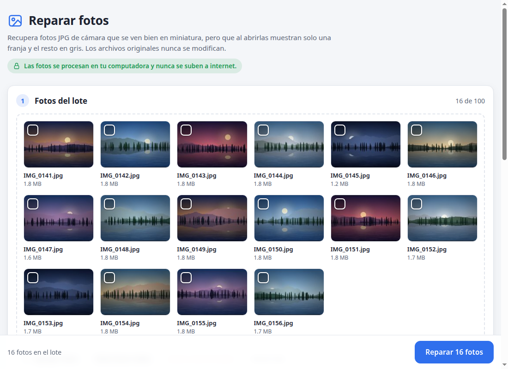
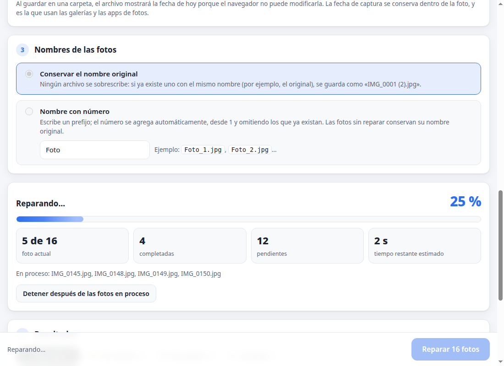
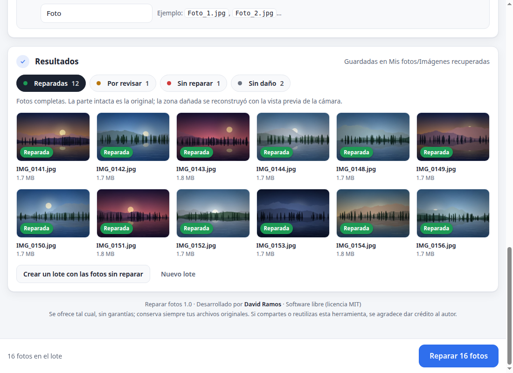
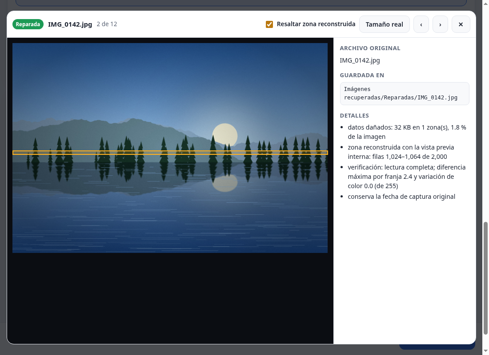

# Reparar fotos

**Recupera fotos JPG de cámara que en la miniatura se ven bien, pero al abrirlas muestran solo una franja y el resto gris.**

Es gratis, no se instala y funciona sin internet: tus fotos nunca salen de tu computadora.



## ¿Es tu caso?

- En la galería o en la vista previa, la foto se ve completa.
- Al abrirla, solo se ve una franja (casi siempre arriba) y lo demás está gris.
- Es una foto **JPG** tomada con una **cámara**.

Si es así, lo más probable es que una parte muy pequeña del archivo se haya dañado al copiarlo o transferirlo. El resto de la foto sigue ahí, y esta herramienta lo recupera.

## Cómo usarla

1. **Descarga** el archivo `reparar_fotos.html` desde la sección [Releases](../../releases/latest), en la columna derecha de esta página.
2. **Ábrelo con Google Chrome o Microsoft Edge**: haz doble clic en el archivo o arrástralo a una ventana del navegador.
3. **Arrastra tus fotos**, elige en qué carpeta guardar y presiona **Reparar fotos**.

**¿Prefieres no descargar nada?** Úsala en línea en **[davidramosv.github.io/reparar-fotos](https://davidramosv.github.io/reparar-fotos/)**. Funciona igual, y tus fotos tampoco se suben a ningún lado.



Al terminar verás una animación, y tus fotos quedarán en una carpeta nueva llamada **Imágenes recuperadas**, separadas así:

| Carpeta | Qué significa | Qué hacer |
|---|---|---|
| **Reparadas** | La foto quedó completa. | Nada: ya puedes usarla. |
| **Por revisar** | Se reparó, pero conviene revisarla. El motivo aparece en la página y en `reporte.txt`. | Ábrela y revísala. |
| **Sin reparar** | Es una copia exacta del original; este método no aplica a esa foto. | Consulta [Si una foto queda sin reparar](#si-una-foto-queda-sin-reparar). |

Las fotos que no tenían daño no se copian. **Tus originales nunca se modifican ni se reemplazan.**

> **Antes de empezar:** si la foto todavía está en la tarjeta de memoria de la cámara, cópiala de nuevo con un lector de tarjetas. Esa copia puede estar completa y no necesitarás reparar nada.

<details>
<summary><strong>Ver más capturas</strong></summary>

Durante el proceso, la página muestra la foto actual, las pendientes y el porcentaje de avance:



Los resultados quedan separados en pestañas, y puedes abrir cada foto para revisarla:



</details>

## Qué tan bien queda

- **La parte sana queda idéntica a la original.** No se vuelve a comprimir ni pierde calidad.
- **Solo la zona dañada se reconstruye**, a partir de la vista previa que la cámara guarda dentro de cada foto. Como esa vista previa es más pequeña, la zona reconstruida se ve un poco menos nítida. En los casos probados ocupó entre el 0.5 % y el 2 % de la altura de la foto.
- **Conserva los datos de la cámara**: la fecha en que tomaste la foto, el modelo de cámara y la ubicación GPS, si la tenía.

En el visor puedes resaltar la zona reconstruida para identificarla:



## Qué puede reparar y qué no

**Sí puede reparar:**

- Fotos JPG de cámara con una o varias partes dañadas, ya sea con datos basura o con huecos vacíos.
- Fotos a las que les falta el final del archivo. Quedan marcadas como «Por revisar», porque la parte faltante se reconstruye con la vista previa o, si también se perdió, con una miniatura muy pequeña.

Se probó con fotos de una **Canon EOS Rebel T8i**: una con daño real y decenas de casos simulados. Otras cámaras que guardan una vista previa grande dentro del JPG deberían funcionar igual. Si algo no coincide, la herramienta marca la foto como «Por revisar» en lugar de inventar información.

**No puede reparar:**

- Fotos **HEIC** (el formato normal del iPhone), PNG, RAW (CR2, CR3, NEF, ARW…) ni videos.
- JPG **progresivos**, comunes en fotos que pasaron por WhatsApp, redes sociales o algunos editores.
- Fotos con el **inicio del archivo dañado**, que es donde están los datos para poder leerla.
- Fotos **borradas** o tarjetas formateadas: esta no es una herramienta para recuperar archivos borrados.
- **El detalle exacto de la zona perdida.** Esos datos ya no existen; se reconstruyen con la vista previa.

**Sin probar:** fotos JPG tomadas con celular. Muchas no guardan una vista previa grande, así que la zona perdida quedaría borrosa y la foto quedaría «Por revisar».

## Si una foto queda sin reparar

- **Busca otra copia del original**: en la tarjeta de la cámara, en tu nube (por ejemplo, en iCloud.com con «Descargar original») o con quien te la envió. Pídela como archivo, no como foto, para que no se comprima.
- **Revisa el motivo**: abre la foto en la página; el panel de detalles lo explica.
- **Guarda la vista previa**: si la foto incluye una, el visor la muestra y puedes guardarla con clic derecho → *Guardar imagen como*. Es más pequeña que la original, pero muestra la foto completa.
- Si es un JPG progresivo o de otro tipo, este método no aplica. Un servicio especializado en recuperación de archivos podría ayudarte.

## Privacidad y seguridad

- **Nada sale de tu computadora.** La página trae una regla de seguridad (*Content-Security-Policy*) que le prohíbe conectarse a internet: aunque quisiera, no podría enviar tus fotos.
- **No hay servidor ni respaldos.** Ningún servidor recibe tus fotos, así que no existe ningún lugar donde pudiera quedar una copia. En la versión en línea, GitHub solo entrega la página, como cualquier sitio web.
- **No se instala**, no usa cookies y no guarda nada en el navegador.
- **Solo escribe donde tú le indicas**: en la carpeta que elijas (el navegador te pide permiso) o en el ZIP que descargas.
- **Nunca reemplaza un archivo.** Si ya existe uno con el mismo nombre, guarda una copia nueva, por ejemplo «IMG_0001 (2).jpg».
- **Compruébalo tú:** desconéctate de internet y repara tus fotos: funciona igual. Si usas la versión en línea, desconéctate después de que cargue la página.
- **Úsala solo desde este repositorio o desde [davidramosv.github.io/reparar-fotos](https://davidramosv.github.io/reparar-fotos/).** Una copia modificada por otra persona podría no ser segura. Cada versión en *Releases* incluye su huella SHA-256 para comprobarlo, y la versión en línea es el mismo archivo (ver [SECURITY.md](SECURITY.md)).
- Las fotos reparadas **conservan la ubicación GPS** si la tenían. Tenlo en cuenta al compartirlas.

## Preguntas frecuentes

<details>
<summary><strong>¿Se suben mis fotos a GitHub?</strong></summary>

No, en ninguna de las dos versiones. En la versión en línea, GitHub solo entrega la página, como cualquier sitio web, y puede registrar la visita (por ejemplo, tu dirección IP). Tus fotos nunca salen de tu navegador: la página tiene bloqueada cualquier conexión, así que no podría enviarlas aunque quisiera.

Para comprobarlo, desconéctate de internet después de que cargue la página: la herramienta sigue funcionando y lo indica en la parte superior.

</details>

<details>
<summary><strong>¿Conviene más usarla en línea o descargada?</strong></summary>

Las dos procesan tus fotos igual, en tu computadora. Lo que cambia es esto:

| | En línea | Descargada |
|---|---|---|
| Para empezar | Abres el enlace | Descargas un archivo |
| Internet | Solo para cargar la página | Solo para descargarla |
| Versión | Siempre la más reciente | La que descargaste; puedes comprobar su huella SHA-256 |
| Qué ve GitHub | Cada visita, como en cualquier sitio web | Solo la descarga |

La versión descargada es la opción más privada: GitHub solo ve la descarga y el archivo no cambia sin que lo sepas.

</details>

<details>
<summary><strong>¿Por qué la miniatura se ve bien y la foto no?</strong></summary>

Una foto de cámara guarda, dentro del mismo archivo, la imagen grande y una o dos vistas previas pequeñas. Si se daña un pedazo de la imagen grande, los programas dejan de leerla en ese punto y pintan de gris todo lo que sigue, porque el formato JPG no permite retomar la lectura después de un error. La vista previa está en otra parte del archivo, por eso se ve bien.

Lo que sigue después del daño casi siempre está intacto. La herramienta retoma la lectura justo después del daño y vuelve a armar la foto.

</details>

<details>
<summary><strong>¿Por qué la foto reparada dice que el archivo se creó hoy?</strong></summary>

Al guardar en una carpeta, el navegador no puede cambiar la fecha del archivo. La fecha en que tomaste la foto sí queda dentro de la foto, y es la que usan las galerías y las apps de fotos para ordenarla.

Si quieres que el archivo también tenga esa fecha, elige **Descargar un ZIP**: al descomprimirlo, cada foto conserva su fecha de captura.

</details>

<details>
<summary><strong>¿Qué navegador necesito?</strong></summary>

Google Chrome o Microsoft Edge en una computadora, para guardar directo en una carpeta. En otros navegadores, como Firefox o Safari, usa la opción **Descargar un ZIP**.

Se probó en Google Chrome para Linux. No se ha probado en celulares.

</details>

<details>
<summary><strong>Chrome no me deja elegir la carpeta Descargas o Documentos</strong></summary>

Chrome protege esas carpetas. Crea o elige una carpeta dentro de ellas, o usa la carpeta Imágenes.

</details>

<details>
<summary><strong>¿Funciona sin internet?</strong></summary>

Sí. La versión descargada funciona sin conexión desde el principio, y la versión en línea solo necesita internet para cargar la página.

</details>

<details>
<summary><strong>¿Cuánto tarda?</strong></summary>

Depende de tu computadora. En las pruebas, 40 fotos de 24 megapíxeles tardaron unos 10 segundos.

</details>

<details>
<summary><strong>¿Puedo reparar más de 100 fotos?</strong></summary>

Sí, en varios lotes. Cada lote admite hasta 100 fotos de hasta 300 MB cada una. Si eliges ZIP, el lote no puede pasar de 4 GB; para lotes más grandes, guarda en una carpeta.

</details>

<details>
<summary><strong>¿Es gratis? ¿Puedo compartirla?</strong></summary>

Sí. Es software libre con licencia MIT: puedes usarla, copiarla y compartirla.

La forma más fácil de compartirla es enviar el enlace a la versión en línea, [davidramosv.github.io/reparar-fotos](https://davidramosv.github.io/reparar-fotos/). Así, quien lo abra usará siempre la versión original y más reciente, y no una copia que alguien pudo haber modificado.

</details>

## Para usuarios avanzados

<details>
<summary><strong>Versión de línea de comandos (Python)</strong></summary>

`reparar_fotos.py` hace la misma reparación desde la terminal y, además, pone a cada archivo la fecha de captura. Necesita Python 3 y [Pillow](https://pypi.org/project/pillow/):

```bash
python3 -m pip install --user Pillow
python3 reparar_fotos.py CARPETA_CON_FOTOS
```

Las reparadas quedan en `CARPETA_CON_FOTOS/recuperadas/`, junto con `reporte.txt`, que indica el resultado de cada foto. Opciones: `--salida CARPETA` y `--procesos N`. Nunca sobrescribe: si el archivo de salida ya existe, omite esa foto.

</details>

<details>
<summary><strong>Cómo funciona</strong></summary>

1. Las fotos JPG de cámara guardan la imagen como un flujo continuo de datos comprimidos (JPEG *baseline* sin marcadores de reinicio). Un solo bloque dañado desincroniza la lectura, y los visores se detienen ahí.
2. La herramienta encuentra las zonas dañadas (marcadores inválidos o tramos de ceros) y retoma la lectura después de cada una, probando desde qué bit los datos vuelven a tener sentido.
3. Ubica cada tramo sano en su lugar de la imagen. Para confirmarlo, compara el brillo y el color de cada bloque con la vista previa interna (la imagen guardada en el segmento MPF).
4. Corrige el color de cada tramo: los valores DC de JPEG son relativos al bloque anterior, que se perdió con el daño.
5. Rellena los bloques perdidos codificando la vista previa ampliada con las mismas tablas de la foto, y copia los tramos sanos tal cual, sin recomprimirlos.
6. Arma el archivo con los mismos datos de la cámara (Exif, XMP y MPF con la vista previa al final), comprueba que se lea completo y lo clasifica.

Todo está escrito en JavaScript dentro de la misma página y corre en *Web Workers*, sin bibliotecas externas.

</details>

## Aviso

Esta herramienta se ofrece **tal cual, sin garantías** de ningún tipo; consulta la [licencia](LICENSE). Úsala bajo tu propio riesgo y **conserva siempre tus fotos originales**.

Las fotos reparadas contienen una parte reconstruida a partir de la vista previa de la cámara. No las uses como prueba de que una imagen no fue alterada.

Canon, iPhone, Chrome, Edge, Firefox, Safari, WhatsApp e iCloud son marcas de sus respectivos dueños. Este proyecto no tiene relación con ellos.

## Reportar un problema

Abre un *issue* en este repositorio y describe qué pasó. **No adjuntes tus fotos**: los *issues* son públicos y las fotos pueden incluir tu ubicación. En su lugar, copia lo que dice `reporte.txt` sobre esa foto.

Para reportar un problema de seguridad, consulta [SECURITY.md](SECURITY.md).

## Créditos

Desarrollado por **David Ramos**.

Si usas esta herramienta en un proyecto, una publicación o un tutorial, o compartes una versión modificada, se agradece dar crédito al autor. Por ejemplo:

> «Reparar fotos», de David Ramos, con un enlace a este repositorio.

## Licencia

[MIT](LICENSE) © 2026 David Ramos. Si redistribuyes el código o una versión modificada, la licencia exige conservar el aviso de copyright y el texto de la licencia.
